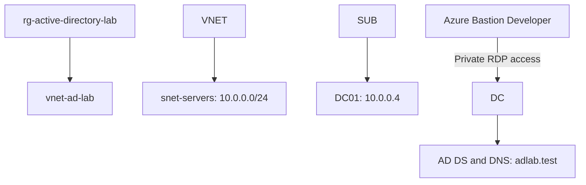

# Active Directory Administration Lab on Microsoft Azure

**Author:** Sophia Agbemashior  
**Completed:** October 13, 2026  
**Project type:** Personal hands-on lab with fictional employees and simulated help desk scenarios.

I built an Azure resource group and virtual network, deployed Windows Server 2025, and configured it as the first domain controller for `adlab.test`. I practiced user and group administration, password resets, account disabling and re-enabling, department transfers, and limited help desk delegation. I validated selected domain-controller services and DNS records, then configured a workstation screen-lock GPO.

## What this project demonstrates

* Azure infrastructure setup: resource group, virtual network, subnet, VM, and static private IP allocation.
* Installation of Active Directory Domain Services (AD DS) and DNS.
* Organizational unit (OU), user, and security-group administration.
* Simulated account lifecycle and help desk tasks.
* Least-privilege delegation with both an allowed and a denied password-reset test.
* PowerShell administration and targeted AD/DNS verification.
* Creation and OU linking of a computer-scoped Group Policy Object (GPO).

## Architecture

The VM has no public IP. Administration used Azure Bastion Developer. This diagram shows the logical access path; Developer uses shared infrastructure.

## Environment

|Item|Configuration|
|-|-|
|Subscription|Azure for Students|
|Resource group|`rg-active-directory-lab`|
|Region|Mexico Central|
|Virtual network|`vnet-ad-lab`|
|Subnet|`snet-servers`, `10.0.0.0/24`|
|VM|`DC01`|
|Operating system|Windows Server 2025 Datacenter|
|VM size|Standard B2als v2; 2 vCPU, 4 GiB RAM|
|OS disk|Standard SSD, 127 GiB|
|Network interface|`dc01511`|
|Private IP|`10.0.0.4`, static allocation in Azure|
|Guest network configuration|DHCP retained in Windows|
|Public IP|None|
|Network security group|`DC01-nsg`|
|Administrative access|Azure Bastion Developer|
|AD forest/domain|`adlab.test`|
|NetBIOS name|`ADLAB`|
|Forest/domain functional levels|Windows Server 2025|
|Domain-controller capabilities|DNS server and Global Catalog|

## Completed work

|Area|Outcome|
|-|-|
|Infrastructure|Resource group and network created before VM deployment|
|Domain deployment|DC01 promoted into a new forest; domain visible in AD Users and Computers|
|Directory organization|LabCorp OU with IT, HR, Finance, Groups, and Workstations child OUs|
|User provisioning|Fictional accounts for Alex Morgan, Jamie Carter, and Taylor Brooks|
|Groups|Department Global Security groups and a help desk password-reset group|
|Password reset|Alex's password reset through AD Users and Computers|
|Account lifecycle|Jamie disabled and re-enabled|
|Department transfer|Taylor moved from Finance to HR; Finance group removed and HR group added|
|Delegation|Password reset and forced password change delegated on HR OU|
|Boundary test|Explicit help desk credentials: HR reset succeeded; IT reset denied|
|AD health|Advertising, Services, SysVolCheck, and NetLogons tests passed|
|DNS|DC01 A record and LDAP domain-controller SRV record resolved|
|Group Policy|900-second machine inactivity setting configured in a GPO linked to Workstations|

## Directory structure and final lab state

|OU under LabCorp|Contents|
|-|-|
|IT|Alex Morgan; Helpdesk Technician|
|HR|Jamie Carter; Taylor Brooks after the transfer exercise|
|Finance|Empty after Taylor's transfer|
|Groups|`GG\_IT\_Users`, `GG\_HR\_Users`, `GG\_Finance\_Users`, `GG\_HelpDesk\_PasswordReset`|
|Workstations|Empty; no client joined|

Department group membership alone does not grant access to a resource. This lab did not assign department groups to file-share or application permissions.

## Verification highlights

Using the same explicitly supplied `ADLAB\\helpdesk.tech` credential:

* Reset of `alex.morgan` in IT returned **Access is denied**.
* Reset of `jamie.carter` in HR completed without an error.
* Requiring Jamie to change the password at next logon completed; `pwdLastSet = 0` was verified.

All four selected `dcdiag` checks passed. DNS resolved `DC01.adlab.test` to `10.0.0.4`; the LDAP SRV record pointed to `dc01.adlab.test`, port 389.

See [validation](docs/validation.md) for commands and results.

## Scope and limitations

This is a single-domain-controller learning environment, not a production deployment. It has no redundancy or tested disaster recovery. Database, logs, and SYSVOL use the OS disk for the budget lab.

The workstation screen-lock GPO is configured and linked. **Client application and actual screen locking have not been tested:** Workstations contains no computer accounts. No client domain join, account lockout/unlock test, multi-DC replication test, file-share authorization test, or Entra ID integration is claimed.

The early VM-agent warning was observed but its resolution was not verified. Cost controls are described as operational steps, not as already completed.

## Project files

* [Build walkthrough](docs/build-walkthrough.md)
* [Simulated help desk tickets](docs/help-desk-tickets.md)
* [Validation and limitations](docs/validation.md)
* [Troubleshooting](docs/troubleshooting.md)
* [Evidence and publishing guide](docs/evidence-and-publishing.md)

## Evidence

Screenshots were captured during the lab and reviewed at checkpoints. Public screenshot copies still need to be cropped, renamed, and added using the [evidence guide](docs/evidence-and-publishing.md). No screenshot links are presented as already published.

## References

* [AD DS deployment](https://learn.microsoft.com/en-us/windows-server/identity/ad-ds/deploy/install-active-directory-domain-services--level-100-)
* [AD DS on an Azure VM](https://learn.microsoft.com/en-us/windows-server/identity/ad-ds/deploy/virtual-dc/adds-on-azure-vm)
* [Set-ADAccountPassword](https://learn.microsoft.com/en-us/powershell/module/activedirectory/set-adaccountpassword?view=windowsserver2025-ps)
* [Machine inactivity limit](https://learn.microsoft.com/en-us/previous-versions/windows/it-pro/windows-10/security/threat-protection/security-policy-settings/interactive-logon-machine-inactivity-limit)
* [Azure VM states and billing](https://learn.microsoft.com/en-us/azure/virtual-machines/states-billing)

